[English](User_Manual.md) | [简体中文](User_Manual_zh.md)

# TA&MO User Manual

  
   
  <strong>🌍 <a href="http://47.93.90.208:8080/tamo" target="_blank">Official Website: http://47.93.90.208:8080/tamo</a></strong>

 

The TA&MO platform is a robust role-based system for managing Teaching Assistant recruitment. Use this documentation to understand core concepts, set up your account, and execute role-specific tasks.

---

## Table of Contents
- [Quickstart](#quickstart)
- [Applicant Guide](#applicant-guide)
- [Organiser Guide](#organiser-guide)
- [Admin Reference](#admin-reference)

---

## Quickstart

Get authenticated and set up your profile immediately.

### Log in to the platform
Navigate to `http://47.93.90.208:8080/tamo`. Enter your university email and password.

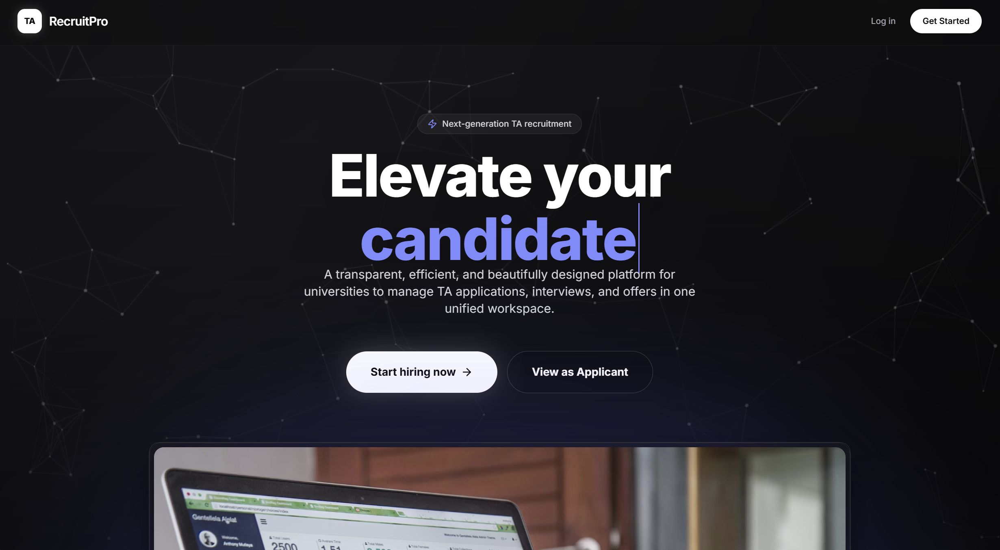
**UI Breakdown:**
- 🔹 **Email & Password Fields**: Inputs for credentials.
- 🔹 **Interactive Security Animation**: The Rive character tracks cursor input and covers its eyes during password entry.

### Create a new account
If you do not have an account, register as a new applicant.

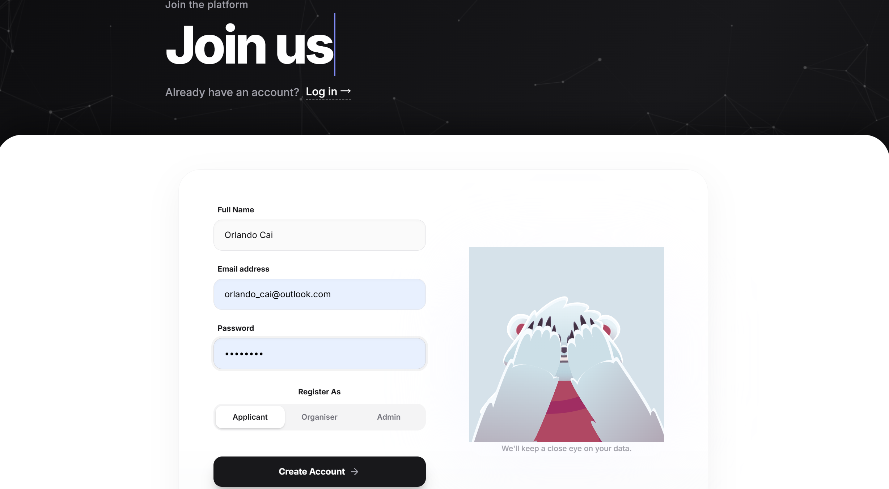
**UI Breakdown:**
- 🔹 **Role Selection**: Locked to 'Applicant' for self-registration.
- 🔹 **Form Validation**: Real-time error highlighting for mismatched passwords or invalid emails.

---

## Applicant Guide

Instructions for browsing jobs, submitting applications, and communicating with organisers.

### Navigate the Dashboard
The Applicant Dashboard provides a high-level summary of your recruitment status.

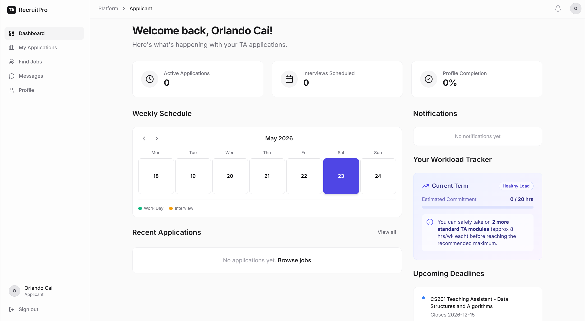
**UI Breakdown:**
- 🔹 **Left Sidebar**: Primary navigation hub.
- 🔹 **Welcome Header**: Account overview and total active applications.
- 🔹 **Quick Stats Cards**: Aggregate status counts.

### View system notifications
Check real-time alerts regarding your applications.

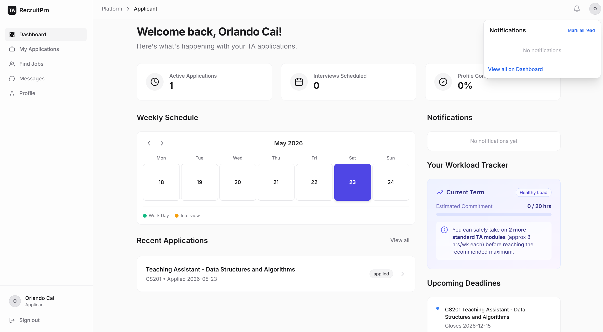
**UI Breakdown:**
- 🔹 **Notifications Panel (Right)**: Displays alerts like "Interview Scheduled" or "Status Updated".

### Search for open positions
Browse available modules and filter by department.

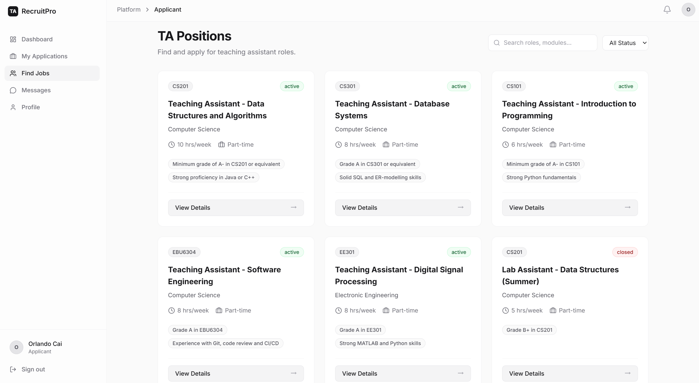
**UI Breakdown:**
- 🔹 **Search & Filter Bar**: Filter by academic department.
- 🔹 **Job Cards**: High-level summary of module code, title, and required hours.

### Review job prerequisites
Click a job card to view detailed requirements.

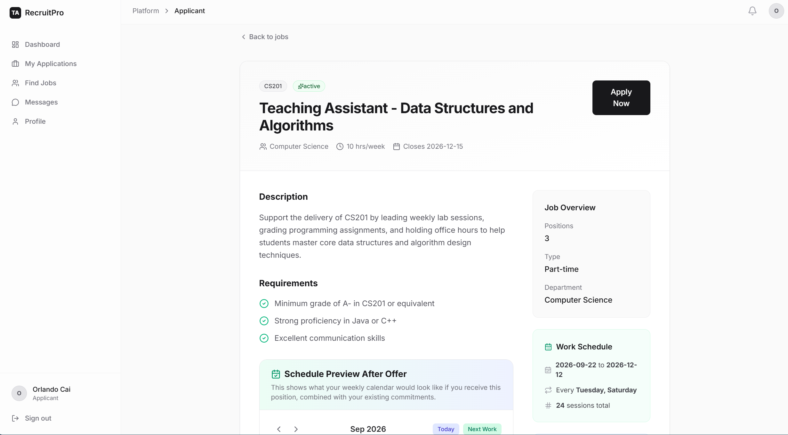
**UI Breakdown:**
- 🔹 **Description Panel**: Full list of responsibilities and required skills.
- 🔹 **Apply Button**: Triggers the application workflow.

### Submit an application
Provide a cover letter to finalize your application submission.

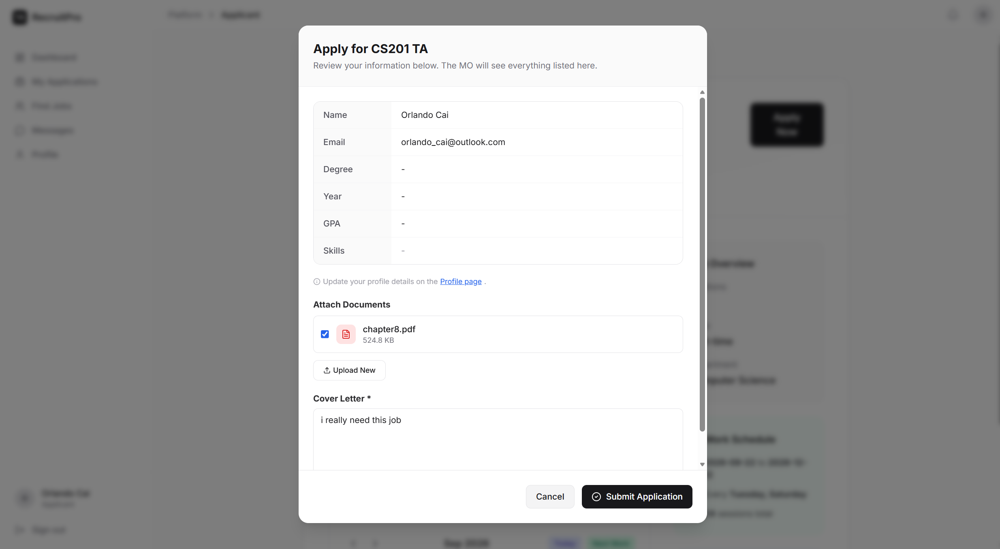
**UI Breakdown:**
- 🔹 **Cover Letter Input**: Textarea for customized application intent.
- 🔹 **Submit Button**: Locks in current profile data and submits application.

### Track application status
Monitor progression through the recruitment pipeline.

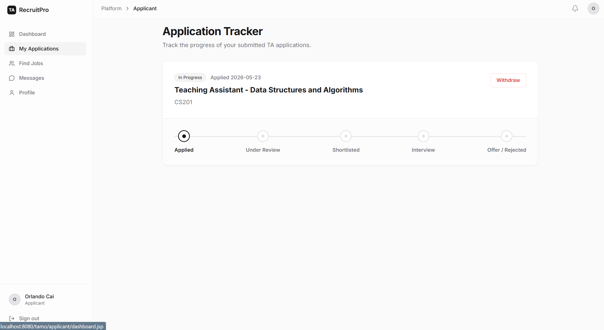
**UI Breakdown:**
- 🔹 **Status Badges**: Color-coded indicators denoting pipeline stage (Review, Shortlisted, Interview, Offer, Rejected).
- 🔹 **Withdraw Action**: Button to retract an active application.

### Build your academic profile
Complete your profile to satisfy job prerequisites.

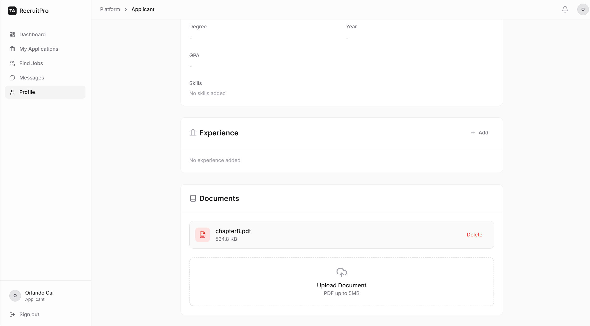
**UI Breakdown:**
- 🔹 **Academic Details**: Inputs for GPA, major, and degree level.
- 🔹 **Skills Tags**: Selectable skills relevant to technical modules.
- 🔹 **Document Upload**: Secure attachment of CVs and transcripts.

### Message module organisers
Initiate or respond to chat threads with professors.

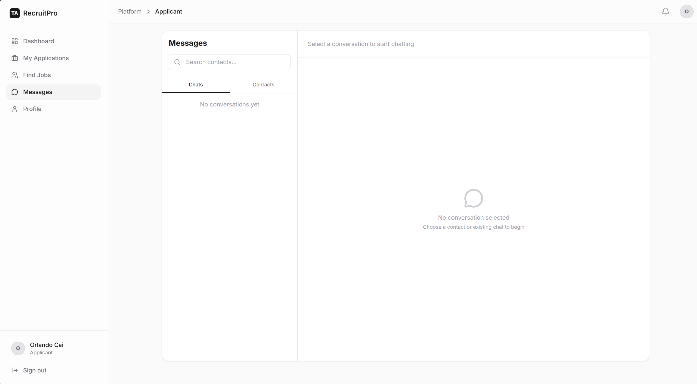
**UI Breakdown:**
- 🔹 **Contact List (Left)**: Permitted contacts based on active applications.
- 🔹 **Empty State**: Default view when no conversation is active.

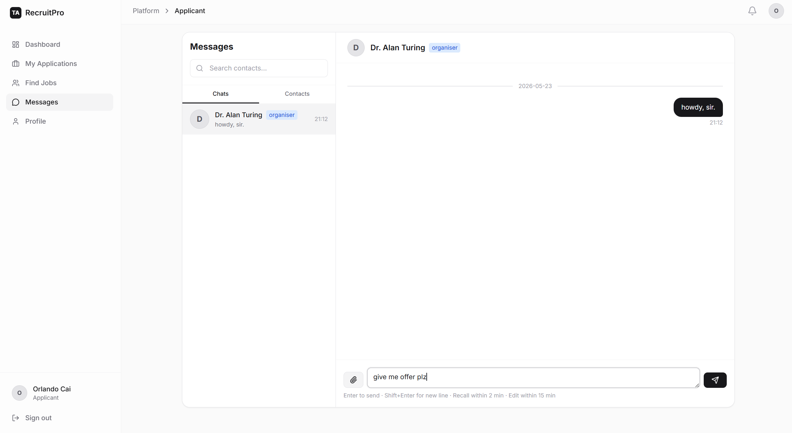
**UI Breakdown:**
- 🔹 **Chat History**: Chronological message feed.
- 🔹 **Message Input**: Textarea for drafting inquiries.

---

## Organiser Guide

Instructions for managing job postings, reviewing candidates, and scheduling interviews.

### View module overview
Access aggregated metrics for your assigned modules.

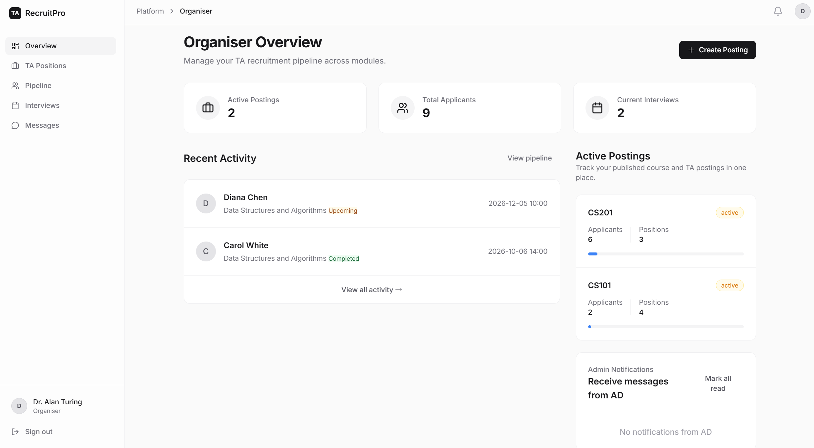
**UI Breakdown:**
- 🔹 **Module Capacity Cards**: Ratio of hired TAs vs. required TAs.
- 🔹 **Recent Activity**: Timeline of incoming applications.

### Manage TA postings
Publish, edit, or toggle visibility of module listings.

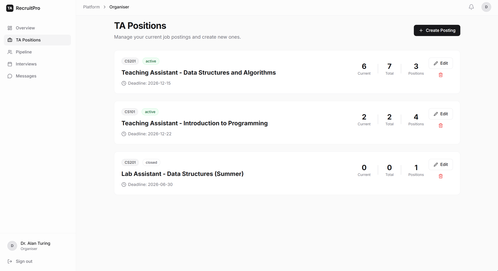
**UI Breakdown:**
- 🔹 **Create New Job**: Button to initialize a new job posting.
- 🔹 **Job List Table**: Actionable rows for toggling visibility or editing details.

### Progress candidates through the pipeline
Use the Kanban board to manage recruitment stages.

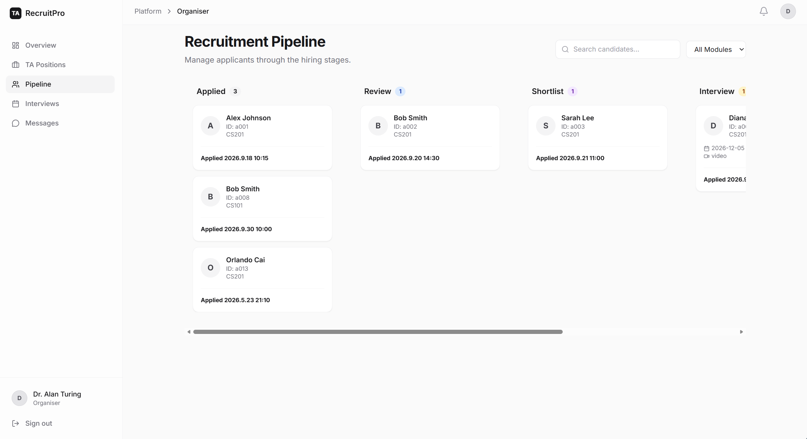
**UI Breakdown:**
- 🔹 **Pipeline Columns**: Distinct stages (Applied, Review, Shortlisted, Interview, Offer).
- 🔹 **Drag-and-Drop Interface**: Click and drag candidate cards across columns to update their status.
- 🔹 **Automated Notifications**: System dispatches alerts automatically upon status change.

### View scheduled interviews
Check upcoming meetings with shortlisted candidates.

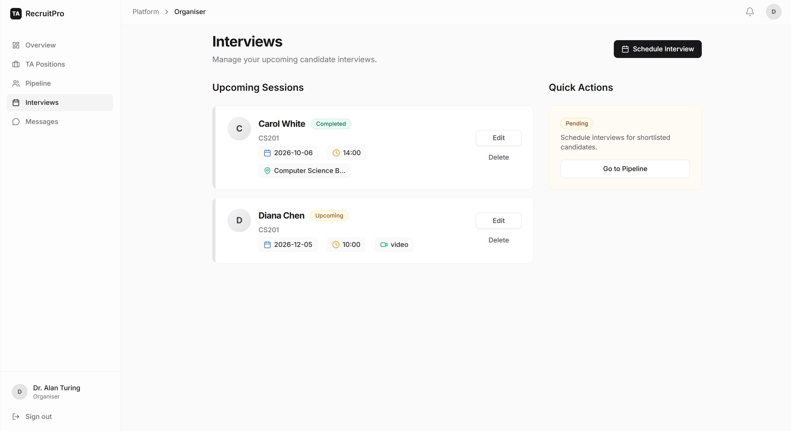
**UI Breakdown:**
- 🔹 **Upcoming Interviews Table**: Chronological list of meetings.
- 🔹 **Status Flags**: Indicators for 'Scheduled' or 'Completed' states.

### Modify existing interviews
Hover over an interview row to reveal management actions.

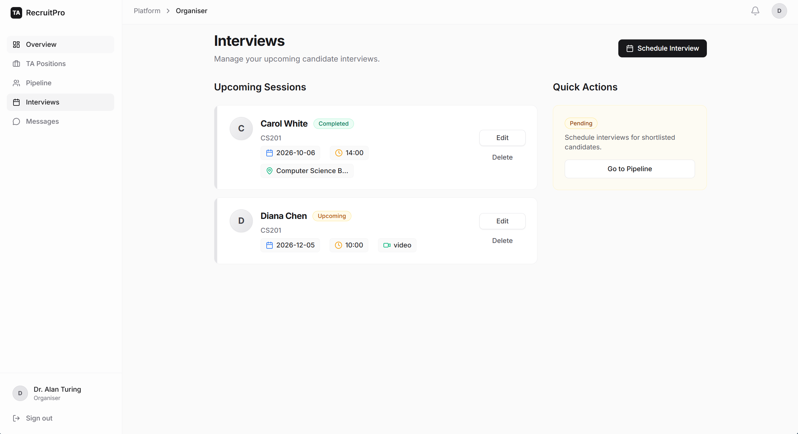
**UI Breakdown:**
- 🔹 **Hover Actions**: Contextual buttons for Edit, Cancel, or Mark as Completed.

### Schedule a new interview
Assign a date, time, and format for a candidate meeting.

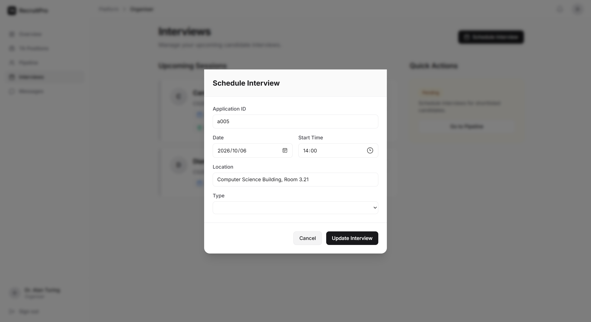
**UI Breakdown:**
- 🔹 **Date & Time Pickers**: Inputs for scheduling.
- 🔹 **Format Toggle**: Switch between 'Video Call' (generates link) or 'In-Person' (requires location).

### Message applicants
Communicate directly with candidates.

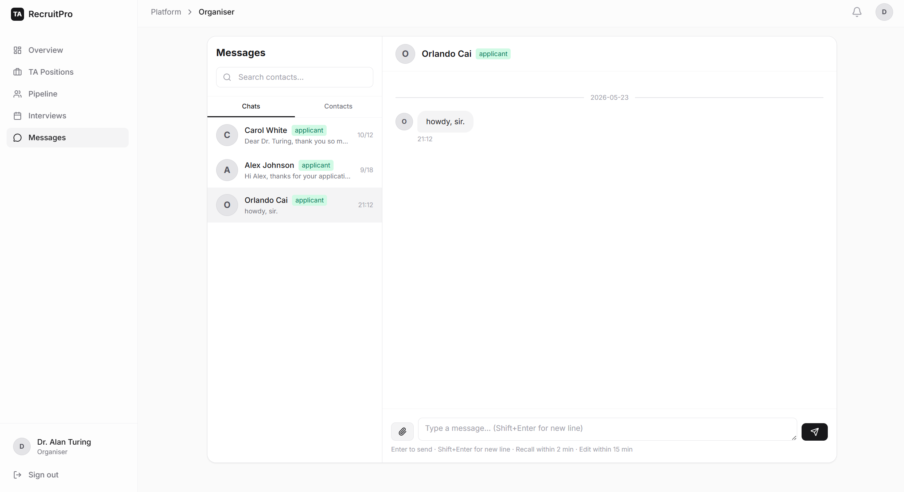
**UI Breakdown:**
- 🔹 **Applicant Roster**: List of candidates grouped by module.
- 🔹 **Chat Interface**: Rich text area for sending feedback.

---

## Admin Reference

Tools for platform auditing, workload intelligence, and global configuration.

> [!CAUTION]
> Admin tools directly modify global state and persistent data. Ensure configurations align with university policy before saving.

### Review platform analytics
Monitor aggregate system health.

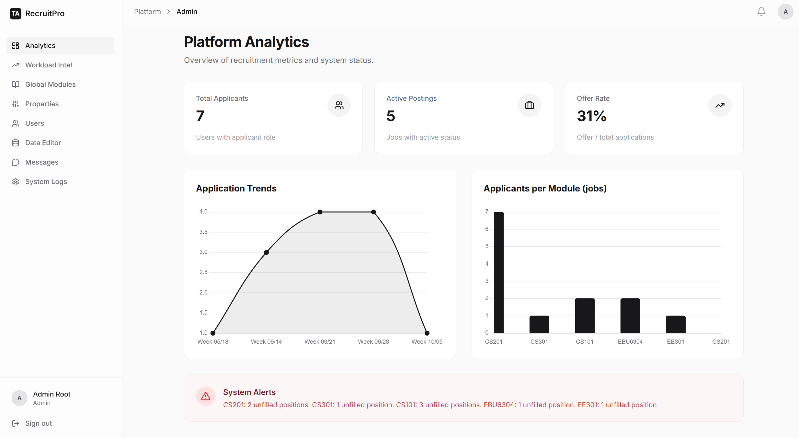
**UI Breakdown:**
- 🔹 **Global Metrics**: Total users, applications, and conversion rates.
- 🔹 **Department Charts**: Visual distribution of TA demand.

### Balance TA workloads via AI
Utilize Workload Intelligence to ensure compliance with maximum working hours.

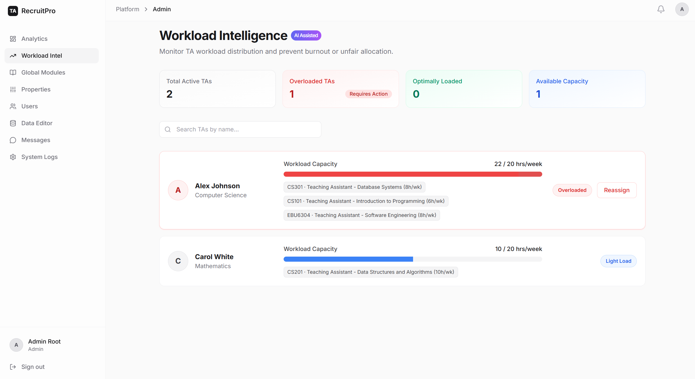
**UI Breakdown:**
- 🔹 **AI Insights Panel**: Automatically flags students exceeding hourly limits.
- 🔹 **Reassignment Tools**: Admin override to transfer offers between candidates.

### Manage global modules
Register new curriculum modules and assign organisers.

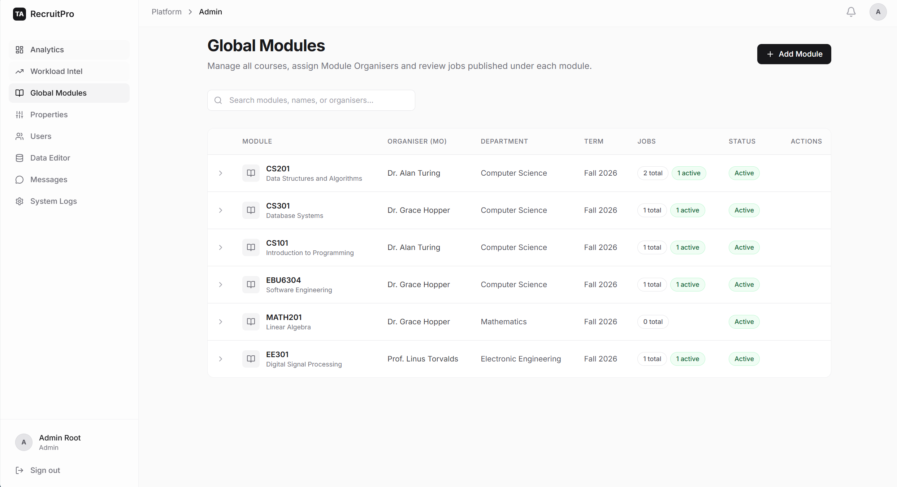
**UI Breakdown:**
- 🔹 **Module Registry**: Table of all system-recognized courses.
- 🔹 **Organiser Assignment**: Dropdown to map professors to specific modules.

### Configure system properties
Set core platform variables.

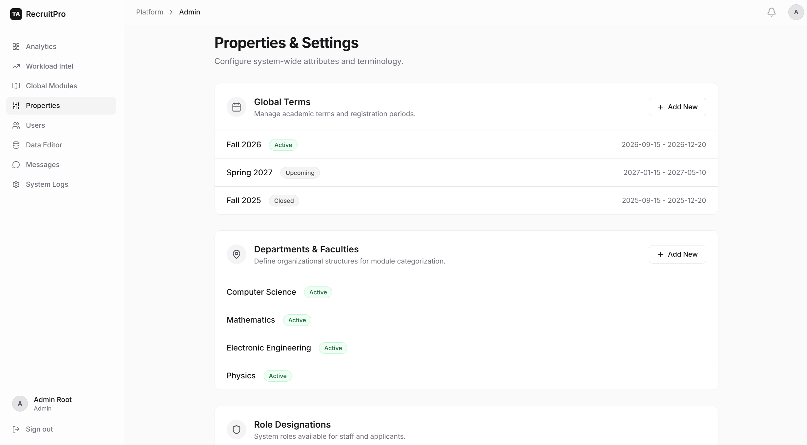
**UI Breakdown:**
- 🔹 **Term Configuration**: Input for current academic semester.
- 🔹 **Department List**: Dynamic CRUD interface for university departments.

### Manage user accounts
Oversee registration and role assignments.

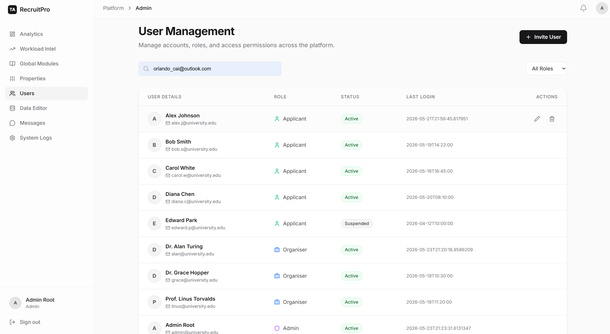
**UI Breakdown:**
- 🔹 **Role Assignment**: Upgrade standard accounts to Organiser or Admin.
- 🔹 **Account Actions**: Suspend or delete malicious users.

### Edit persistent data directly
Bypass business logic to execute raw CRUD operations on the JSON datastore.

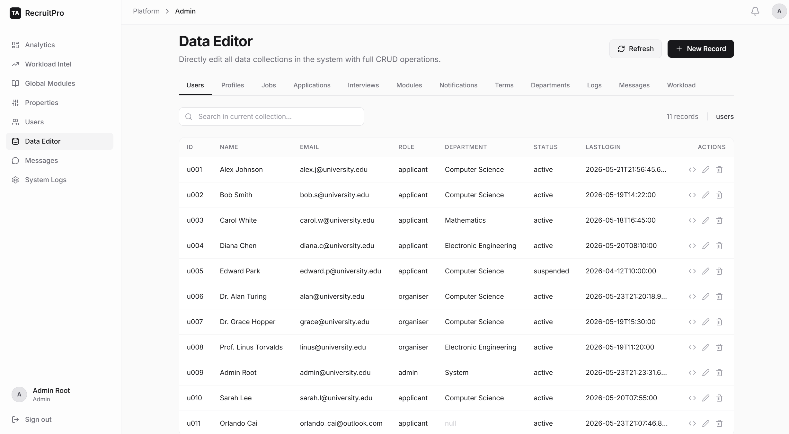
**UI Breakdown:**
- 🔹 **JSON CRUD Interface**: Tabular view of underlying database collections.
- 🔹 **Action Buttons**: Direct edit/delete capabilities for raw entities.

### Audit system logs
Review secure logs for platform activity.

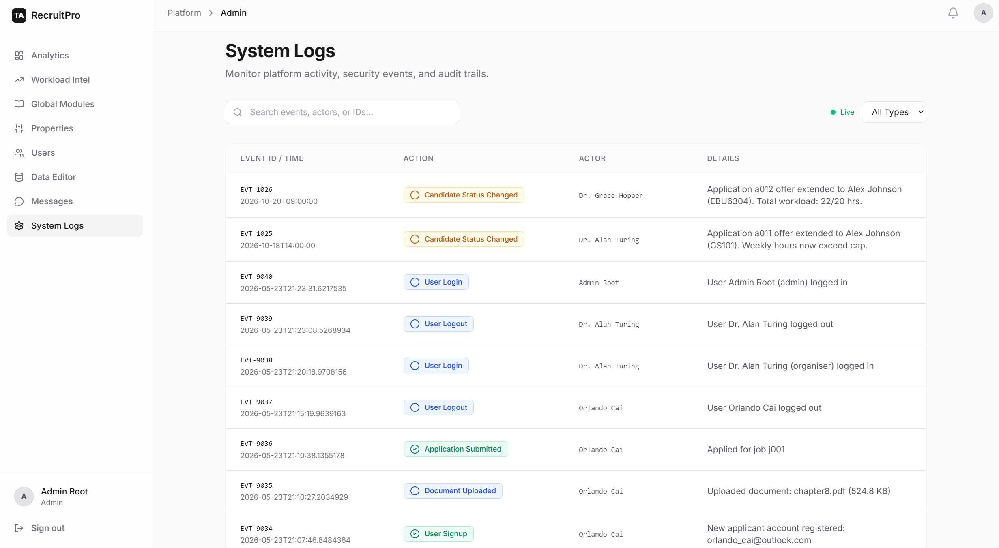
**UI Breakdown:**
- 🔹 **Log Table**: Chronological record of actions, user IDs, and timestamps.
- 🔹 **Severity Filters**: Toggle between INFO, WARNING, and ERROR logs.
